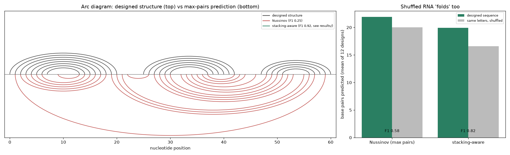

# Nussinov RNA Folding

> Maximise the base pairs and you get a structure. Not *the* structure.

## Demo Output

Produced from designed RNA sequences by `demo.py`: an arc diagram comparing the designed fold with Nussinov's prediction, and how many pairs each method finds in real versus shuffled sequences.

## Why This Exists

Nussinov's algorithm (1978-80) is where every RNA folding course starts. It's a clean dynamic program that finds the structure with the most base pairs. It's also the clearest lesson in why the objective function matters. Real RNA structure is driven by *stacking* between neighbouring pairs, not by the pair count. This repo implements Nussinov and a small stacking-aware variant on the same dynamic program, then tests both against sequences designed to fold into a known three-hairpin structure.

## What's Inside

| Function | Purpose |
|----------|---------|
| `fold(seq)` | Classic Nussinov: maximise pairs (G-C, A-U, G-U), minimum hairpin loop of 3 |
| `fold(seq, stacking=True)` | Same recursion, but rewards stacked pairs and G-C over A-U |
| `pair_f1` | Base-pair F1 against a reference structure |
| `pairs_from_dotbracket` | Convert dot-bracket notation to pair lists |

## When NOT to Use This

- **Real structure prediction.** Use ViennaRNA (RNAfold), RNAstructure or LinearFold. They use measured nearest-neighbour energies.
- **Pseudoknots.** Neither this nor standard Zuker-style algorithms can represent them.
- **Long RNAs.** This is O(n³) in pure Python. Fine for 100 nt, painful for 1,000.

## The Uncomfortable Truth

A shuffled sequence with the same letters gets nearly as many Nussinov pairs as the designed one. "This RNA can form N base pairs" is not evidence that it does. Compare against shuffled controls and use energies.

## Further Reading

- Nussinov R. & Jacobson A. B. "Fast algorithm for predicting the secondary structure of single-stranded RNA." PNAS (1980).
- Zuker M. & Stiegler P. "Optimal computer folding of large RNA sequences using thermodynamics and auxiliary information." Nucleic Acids Research (1981).
- Lorenz R. et al. "ViennaRNA Package 2.0." Algorithms for Molecular Biology (2011).
